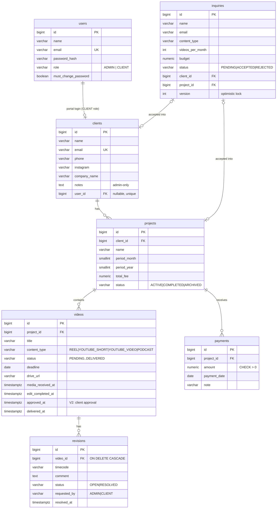

# EditFlow — Architecture

This describes the system **as built**. Setup and commands are in the [README](../README.md).

Contents:

1. [Overview](#1-overview)
2. [Key decisions](#2-key-decisions)
3. [Domain rules](#3-domain-rules)
4. [Database](#4-database)
5. [Video workflow](#5-video-workflow)
6. [Security](#6-security)
7. [API](#7-api)
8. [Backend structure](#8-backend-structure)
9. [Frontend](#9-frontend)
10. [Testing](#10-testing)
11. [Configuration and deployment](#11-configuration-and-deployment)
12. [Known limitations](#12-known-limitations)

---

## 1. Overview

```
┌──────────────────────────────┐   HTTPS/JSON, Bearer JWT   ┌─────────────────────────────────────┐
│ React + Vite SPA             │ ─────────────────────────▶ │ Spring Boot 3.5 monolith (Java 21)  │
│                              │                            │                                     │
│ public  /  /work-with-me     │                            │ Security filter chain               │
│ admin   /admin/**            │                            │  ├─ JWT (HS256) resource server     │
│ client  /portal/**           │                            │  ├─ URL rules by role               │
│                              │                            │  └─ JSON 401/403 handlers           │
│ api/ single Axios instance   │                            │ Controller → HTTP + DTOs only       │
│ context/ per-tab auth        │                            │ Service    → rules, transactions,   │
│ utils/workflow next-step     │                            │              ownership checks       │
│   guidance (presentation)    │                            │ Repository → Spring Data JPA        │
└──────────────────────────────┘                            │ @RestControllerAdvice → ApiError    │
                                                            └─────────────────┬───────────────────┘
                                                                              │ JDBC
                                                                   ┌──────────▼──────────┐
                                                                   │ PostgreSQL          │
                                                                   │ schema via Flyway   │
                                                                   └─────────────────────┘
```

**There is no seed or demo data.** On startup, `AdminBootstrap` creates the single admin from environment variables if none exists. Nothing else is inserted automatically, and every figure the UI shows is derived from real records.

---

## 2. Key decisions

| Decision | Choice | Why |
|---|---|---|
| Code layout | **Package by feature**, layered inside each feature (`video/VideoAdminController`, `VideoService`, `VideoWorkflow`, …) | Layered separation, while each feature stays easy to find |
| Schema | **Flyway** migrations; `ddl-auto=validate` | The same schema everywhere, with real CHECK/UNIQUE/FK constraints. Hibernate never changes the schema. |
| JWT | `spring-boot-starter-oauth2-resource-server` with `NimbusJwtEncoder`/`Decoder` (HS256), issuer `editflow`, claims `role` and `pwd_change` | Spring's validated JWT handling instead of a hand-written filter |
| Token storage | `sessionStorage`, one session **per tab**, no refresh token | Admin and client can be signed in side by side in two tabs. Cross-site httpOnly cookies (Vercel ↔ Render) would add SameSite/CSRF complexity. |
| Authorization | Two layers: URL rules by role, then service-level ownership using the client id from the JWT | The UI hiding things is never relied on (§6) |
| Client DTOs | Separate portal types (`portal/dto`) | Admin-only fields such as client `notes` cannot leak by accident |
| Derived values | Aggregate queries into `VideoStats`, `PaymentSummary`, `RevisionCounts` | No stored counters, no N+1 counting |
| Workflow | `VideoStatus` enum + `VideoWorkflow` (transition table + timestamp side effects) | One place holds the rules. Responses carry `allowedTransitions` so the UI doesn't duplicate them. |
| Money | `BigDecimal` / `NUMERIC(12,2)`, INR | No floating-point money |
| Time | Injectable `Clock` in `app.timezone` (default `Asia/Kolkata`) | Correct "today" near midnight; deterministic tests |
| Open-in-view | Disabled | DTOs are mapped inside service transactions, so there are no lazy-loading surprises |
| Errors | `@RestControllerAdvice`, plus a JSON entry point and access-denied handler for filter-level failures | Every 4xx/5xx uses the same envelope |
| Frontend styling | Tailwind v4 tokens, `lucide-react`, no UI kit | Neutral workspace UI. Red (the brand accent) is reserved for errors, warnings and destructive actions inside the app, and used freely only on the public site. |

---

## 3. Domain rules

| # | Rule |
|---|---|
| R1 | **Accepting an inquiry** creates (or reuses, matched by email) the Client, creates the monthly Project and, if the client has no login, a portal login with a one-time temporary password shown to the admin once. It runs in one transaction with an `@Version` lock on the inquiry, so a double accept returns **409**. |
| R2 | **Portal logins** use BCrypt. A temporary password sets `must_change_password`; until it's changed, the token carries `pwd_change` and every admin/portal route returns **403**. The admin can issue a new temporary password at any time. |
| R3 | **Unique month:** one project per client per month (`UNIQUE (client_id, period_month, period_year)`, so a duplicate returns 409). |
| R4 | **Video statuses** follow §5. Only the admin moves videos, except for the client's approval (REVIEW → COMPLETED). |
| R5 | **Revisions** (`timecode` in `mm:ss` or `hh:mm:ss`, plus a comment) can be requested by the client only when the video is in REVIEW, COMPLETED or DELIVERED. They never change status by themselves. The admin can also log one, e.g. feedback received on WhatsApp, and resolves them. |
| R6 | **Client approval** is allowed only in REVIEW with no open revisions. It sets COMPLETED and `approved_at`. Moving the video back before COMPLETED clears `approved_at`; delivering it keeps it. |
| R7 | **Overdue** means `deadline < today AND status <> DELIVERED`. A completed but undelivered video can be overdue on purpose, because the client doesn't have it yet. |
| R8 | **Payments** are manual records (amount > 0, date not in the future). Overpaying returns 400. A fee cannot drop below what has already been paid. Payments can be deleted to fix typos but not edited. Payments are independent of approval and delivery. |
| R9 | **Payment status** is `paid >= fee → PAID` (a fee of 0 is PAID), `paid == 0 → UNPAID`, otherwise `PARTIALLY_PAID`. A pessimistic lock on the project serialises concurrent payments. |
| R10 | **A client's current project** is the latest ACTIVE one by (year, month); if none is active, the latest project. |
| R11 | **No deletion of clients or projects.** Projects are archived. Videos can be deleted (with their revisions), except DELIVERED ones. |

### Derived values (defined once, in code)

```
totalVideos     = COUNT(videos of project)
doneVideos      = COUNT(status IN (COMPLETED, DELIVERED))
progressPercent = total == 0 ? 0 : round(done * 100 / total, 2)
revisionCount / openRevisionCount per video
totalPaid       = COALESCE(SUM(payments.amount), 0)
balance         = total_fee - totalPaid
outstanding     = SUM(balance) over ACTIVE + COMPLETED projects
dashboard video stats = videos of ACTIVE projects
```

---

## 4. Database

Migrations live in `backend/src/main/resources/db/migration`:

| Version | Content |
|---|---|
| `V1__init_schema.sql` | All tables, constraints and indexes |
| `V2__video_client_approval.sql` | `videos.approved_at TIMESTAMPTZ NULL` |



All tables also have `created_at` (and `updated_at` where they're mutable).

- **Enums** are stored as `VARCHAR` with `CHECK` constraints, not PostgreSQL enum types.
- **JPA mappings** are unidirectional `@ManyToOne(LAZY)` from child to parent, plus Client → User. There are no `@OneToMany` collections, so there are no serialization loops and no accidental collection loading.
- **Indexes** cover the foreign keys, `videos(status)`, `videos(deadline)`, `revisions(video_id, status)` and `inquiries(status)`.

---

## 5. Video workflow

```
             Media received      Start editing      Send to review    ┌─ client approves ─┐     Deliver
 PENDING ───────────────▶ MEDIA_RECEIVED ───────▶ EDITING ───────▶ REVIEW ──────────────▶ COMPLETED ───────▶ DELIVERED
  sets media_received_at                            ▲               │ (admin "Mark approved"  sets edit_completed_at  sets delivered_at
                                                    │               │  for offline approvals) (+ approved_at if client)
                                                    └── revisions ──┘
                                     (client requests revision → admin "Start revisions": REVIEW → EDITING)
```

- **Forward:** one step at a time. Anything else returns **409**: `Cannot change status from X to Y. Allowed: …`.
- **Backward (admin corrections):**
  - MEDIA_RECEIVED → PENDING
  - EDITING → MEDIA_RECEIVED
  - REVIEW → EDITING
  - COMPLETED → REVIEW
  - DELIVERED → EDITING (reopen after a post-delivery change)

  Going back clears the timestamps of the undone stages, including `approved_at` below COMPLETED.
- **Client approval:** `VideoWorkflow.approveByClient` checks REVIEW and that no revisions are open, then calls the package-private `Video.approveAt`. Clients have no general status-change endpoint.
- **Timestamps** are set server-side from the injected `Clock`. Request bodies only carry `{ "status": "EDITING" }`.

**The revision loop:**

```
EDITING → REVIEW → client requests a revision
        → admin: Start revisions (→ EDITING) → resolve each request
        → Send to review (→ REVIEW) → client approves (→ COMPLETED)
        → admin delivers (→ DELIVERED)
```

---

## 6. Security

URL rules (`SecurityConfig`, in order):

| Pattern | Access |
|---|---|
| `/actuator/health`, `/error` | public |
| `POST /api/auth/login`, `/api/public/**` | public |
| `/api/auth/**` | any authenticated user |
| `/api/admin/**` | ADMIN, and no pending password change |
| `/api/client/me/**` | CLIENT, and no pending password change |
| anything else | denied |

**Ownership (second layer).** Portal services resolve the caller's client id with `CurrentUser.clientId()` from the JWT, never from the request. Loading another client's project or video returns **403** ("You do not have access to this …"); unknown ids return **404**.

**Rate limiting.** Limits are counted in memory over fixed time windows, configurable under `app.rate-limit.*`, with no Redis:

| Rule | Where | Default |
|---|---|---|
| Login attempts per client IP | `RequestRateLimitFilter` | 10 / 5 min |
| Inquiry submissions per client IP | `RequestRateLimitFilter` | 5 / hour |
| Failed logins per account | `LoginThrottle` in `AuthService` | 20 / 15 min, cleared by a successful login |

- **Response:** a limited request gets **429** in the usual envelope, with a `Retry-After` header.
- **Client IP:** taken from `X-Forwarded-For`, since the app runs behind Render's proxy. That header can be forged, which is why logins are also limited per account.
- **Tests:** the limits are switched off in the `test` profile; `RateLimitIT` switches them back on.

**Error envelope** (every 4xx/5xx, including filter-level 401/403):

```json
{ "success": false, "status": 409, "message": "Only a video that is ready for your review can be approved",
  "path": "/api/client/me/videos/5/approve", "timestamp": "2026-10-11T08:30:00Z", "errors": [] }
```

`errors[]` carries `{field, message}` for validation failures (400).

---

## 7. API

Successful responses are plain DTOs. Creates return **201**; deletes return **204**.

### Public and auth

| Method | Path | Notes |
|---|---|---|
| POST | `/api/auth/login` | `{email, password}` → `{token, expiresAt, user}` · 401 |
| GET | `/api/auth/me` | Current user |
| POST | `/api/auth/change-password` | `{currentPassword, newPassword}` → fresh token |
| POST | `/api/public/inquiries` | Work With Me form → 201 |
| GET | `/actuator/health` | Only `health` is exposed |

### Admin: `/api/admin` (ADMIN)

| Method | Path | Purpose |
|---|---|---|
| GET | `/dashboard/summary` | Clients, active projects, pending inquiries, open revisions, video stats (ACTIVE projects), fees / paid / outstanding (ACTIVE + COMPLETED) |
| GET | `/dashboard/tasks` | Due today, overdue, in editing, in review, open revisions |
| GET | `/inquiries?status=` · `/inquiries/{id}` | List / detail |
| POST | `/inquiries/{id}/accept` · `/inquiries/{id}/reject` | R1. 409 if not PENDING. |
| GET, POST | `/clients` | List / create (optionally with a portal login) |
| GET, PUT | `/clients/{id}` | Detail / update |
| POST | `/clients/{id}/portal-access` | Create a login or issue a new temporary password |
| GET, POST | `/clients/{clientId}/projects` | List / create (409 for a duplicate month) |
| GET | `/projects?status=` | All projects with video stats and payment summary |
| GET, PUT | `/projects/{id}` | Detail / update (fee ≥ paid) |
| PATCH | `/projects/{id}/status` | ACTIVE / COMPLETED / ARCHIVED |
| GET | `/videos` | All videos of non-archived projects, with project and client |
| GET, POST | `/projects/{projectId}/videos` | List (with `allowedTransitions`, `overdue`, revision counts, `approvedAt`) / create |
| GET, PUT, DELETE | `/videos/{id}` | Detail with revisions / edit / delete (DELIVERED → 409) |
| PATCH | `/videos/{id}/status` | `{status}` → validated transition (§5) |
| GET | `/revisions` | All revisions |
| GET, POST | `/videos/{videoId}/revisions` | List / log a revision |
| POST | `/revisions/{id}/resolve` | RESOLVED + `resolvedAt` |
| GET | `/payments` | Per-project fee / paid / balance / status, plus recent payments and totals |
| GET, POST | `/projects/{projectId}/payments` | History + summary / record a payment |
| DELETE | `/payments/{id}` | Remove a mistaken entry |

### Client portal: `/api/client/me` (CLIENT; no client ids in URLs)

| Method | Path | Purpose |
|---|---|---|
| GET | `/dashboard` | Current project, progress, payment summary, upcoming deadlines |
| GET | `/profile` | Own profile, without `notes` |
| GET | `/projects` · `/projects/{id}` | Own projects (403 if not owned) |
| GET | `/projects/{id}/videos` · `/projects/{id}/payments` | Videos / payment history (403 if not owned) |
| GET | `/videos/{id}` | Video + its revisions (403 if not owned) |
| POST | `/videos/{id}/approve` | **Client approval** (R6) → updated video. 403 if not owned, 404 if unknown, 409 if not in REVIEW or revisions are open. |
| POST | `/videos/{id}/revisions` | `{timecode, comment}` → 201 OPEN (R5) |

---

## 8. Backend structure

```
backend/src/main/java/com/editflow/
├── EditFlowApplication.java
├── common/       config (Clock, CORS, app properties), BaseEntity, exception/ (ApiError,
│                 GlobalExceptionHandler, NotFound/Conflict/BusinessRule/Forbidden/AuthenticationFailed)
├── security/     SecurityConfig, JwtConfig, JwtService, TokenAuthenticationConverter, CurrentUser,
│                 JSON entry point / access-denied handler
├── auth/         login, me, change password
├── user/         User, Role, PasswordGenerator, PortalAccountService
├── seed/         AdminBootstrap (env-driven admin only)
├── inquiry/      public submit + admin review, InquiryAcceptanceService
├── client/       ClientAdminController, ClientService
├── project/      ProjectAdminController, ProjectService, ProjectMetricsService, CurrentProjectSelector
├── video/        VideoAdminController, VideoService, VideoWorkflow, VideoStats, VideoDeadlines
├── revision/     RevisionAdminController, RevisionService, RevisionCounts
├── payment/      PaymentAdminController, PaymentService, PaymentSummary, FinancialTotals
├── dashboard/    AdminDashboardController, DashboardService
└── portal/       ClientPortalController, ClientPortalService, dto/ (client-safe DTOs)
```

---

## 9. Frontend

```
frontend/src/
├── api/            client.js (single Axios instance: VITE_API_URL, Bearer + 401 interceptors),
│                   errors.js (toApiError), one module per area; portal.js never sends client ids
├── context/        AuthContext (per-tab sessionStorage session), ToastContext
├── routes/         AppRoutes, RequireRole guard
├── layouts/        PublicLayout (cinematic), AdminLayout (Workflow / Records nav), PortalLayout
├── pages/public/   Landing, WorkWithMe, Login, ChangePassword, NotFound
├── pages/admin/    Overview ("Today"), Inquiries, Clients, ClientDetail, Projects,
│                   ProjectDetail (project workspace), VideoDetail, Videos, Revisions, Payments
├── pages/portal/   Dashboard, Projects, ProjectDetail, Videos, VideoDetail (approve / revise),
│                   Payments, Profile
├── components/ui/      Button, Card, Badge, Modal, Table, States, StatCard, ProgressBar, ActionMenu, …
├── components/domain/  NextStepCard, StageRail, VideoStatusControl, VideoTimeline, Revision*,
│                       Payment*, *FormModal, ClientVideoList, …
├── cinematic/      public-site motion: ColorBends (three.js), GSAP, Lenis, cursor
│                   (lazy-loaded, with reduced-motion and no-WebGL fallbacks)
├── hooks/          useApi, useForm, useMotion, usePortalProjectSelection
└── utils/          workflow.js (next-step guidance), format, labels, session, validation
```

**Guided workflow (`utils/workflow.js`).** This is presentation only, derived from backend state; legality is still decided by the backend.

| Function | What it gives |
|---|---|
| `videoNextStep` | Whose turn it is, what to do, and what happens next |
| `projectNextStep` | Add your first video → Start editing → Send video for review → Waiting for client review → Address N change requests → Deliver this video → Record payment → Project is financially complete |
| `buildAttention` | The admin's *Today* queue (needs you / waiting on clients) |
| `clientSituation` / `clientVideoStep` | The client's view of the same states |

**Today page.** The action queue comes first. Below it is a quiet Overview of `/dashboard/summary`:

- **Work** (active projects): active projects, clients, active videos, videos delivered.
- **Money** (active and completed projects): project fees, paid, outstanding.

---

## 10. Testing

**Backend.** Run `./mvnw verify` (184 tests).

- **Unit tests** cover:
  - workflow transitions and client approval
  - payment status
  - current-project selection
  - JWT
  - auth service
  - the rate limiter
- **Integration tests** use Spring Boot, MockMvc and Testcontainers PostgreSQL 16, so the real Flyway SQL is what gets tested. Areas covered:

  | Test class | Covers |
  |---|---|
  | `AuthIT` | Login, `/me`, change password |
  | `AuthorizationIT` | URL rules by role, 401/403 |
  | `InquiryIT` | Submit, accept, double accept → 409 |
  | `ClientIT` | Clients and portal access |
  | `ProjectIT` | Projects, unique month, fee rules |
  | `VideoIT` | Videos and status transitions |
  | `RevisionIT` | Revisions and resolving |
  | `PaymentIT` | Payments, overpayment, concurrency |
  | `DashboardIT` | Summary and tasks figures |
  | `ClientPortalIT` | Isolation between clients, approval, the revision loop |
  | `SchemaConstraintsIT` | Database CHECK/UNIQUE constraints |
  | `RateLimitIT` | Login and inquiry limits, per-account lockout, `Retry-After` |

  They are skipped without Docker.

**Frontend.** Run `npm test` (Vitest + Testing Library, 79 tests). Coverage:

- auth and routing guards
- per-tab sessions
- the Axios client
- the Work With Me form
- the video status control
- the payment form
- portal isolation
- client approval
- workflow guidance
- the Today figures
- the cinematic fallbacks
- the legal pages and footer
- the server wake-up notice

---

## 11. Configuration and deployment

All settings come from environment variables (see the README table). Profiles:

- **`local`** (the default when none is set): local database defaults, health details, and a random JWT key if `JWT_SECRET` is unset.
- **`prod`:** requires every secret.

`backend/.env` is optional, gitignored, and imported automatically.

**Hosting:** Vercel (SPA), Render (API, as a Docker container) and Neon (PostgreSQL). The step-by-step checklist is in the README.

| Piece | What it does |
|---|---|
| `backend/Dockerfile` | Multi-stage Maven build onto an `eclipse-temurin:21-jre-alpine` runtime, running as a non-root user. `SPRING_PROFILES_ACTIVE=prod` is baked in, so a missing variable can never fall back to `local`. Memory flags (`MaxRAMPercentage=75`, Serial GC, `ExitOnOutOfMemoryError`) fit a 512 MB instance. |
| `render.yaml` | Blueprint: Docker runtime, `/actuator/health` health check, generated `JWT_SECRET`, prompted database, CORS and admin values. |
| `application.yml` | `forward-headers-strategy: native` (https-aware behind the proxy), Hikari pool of `DB_POOL_SIZE` (default 5), graceful shutdown. |
| `frontend/vercel.json` | SPA rewrite, immutable caching for hashed `/assets`, and `nosniff`, `X-Frame-Options`, `Referrer-Policy` and `Permissions-Policy` headers. |
| Cold starts | Render's free tier sleeps. The SPA pings `/actuator/health` (fire-and-forget, `no-cors`) when public pages or login load. API requests wait up to 75 s, and any request slower than 3.5 s shows a "Waking up the server…" notice (`api/serverStatus.js`, `ServerWakeNotice`). |
| CI | `.github/workflows/ci.yml` runs `./mvnw verify` (with Testcontainers) and the frontend lint, tests and build on every push and pull request. |

---

## 12. Known limitations

- **No refresh tokens.** Sessions expire after `JWT_TTL_MINUTES`.
- **No email, notifications or chat.** Credentials and updates are shared manually.
- **Media lives on Google Drive.** There's no upload or streaming.
- **Payments are records only**, with no gateway.
- **Single admin**, single currency (INR).
- **Rate limits are in memory, per instance.** That's fine for one Render instance; several instances would need a shared store.
- **"Mark approved" by the admin** (for approvals given offline) completes a video without `approved_at`, so only portal approvals are labelled "Approved by client".
